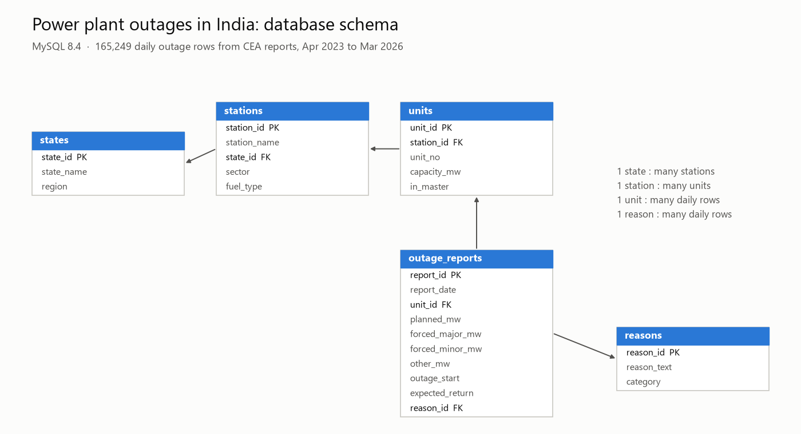
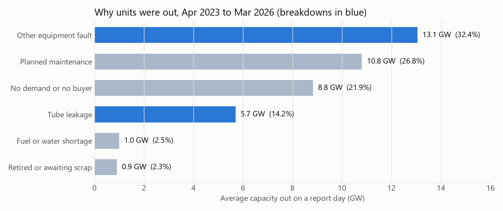
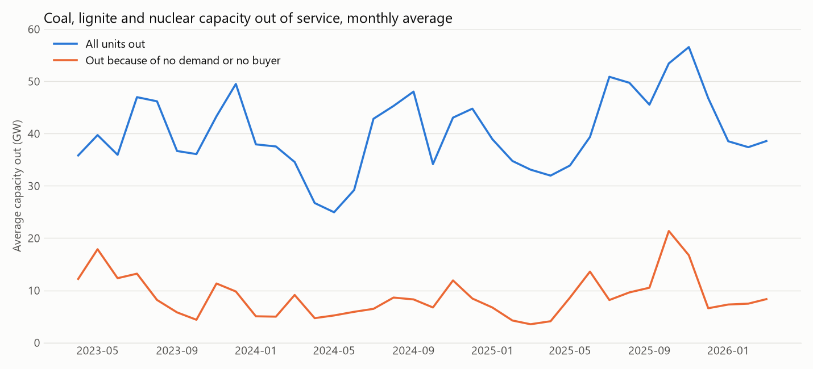
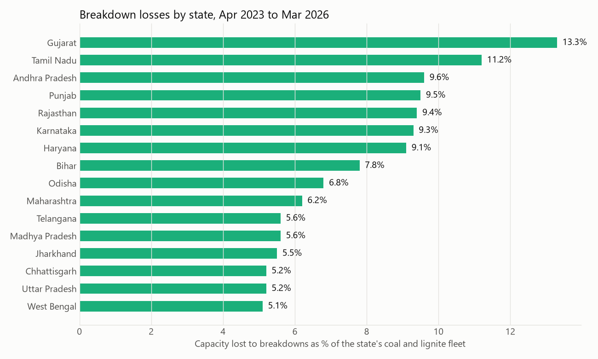

# Why are India's power plants out of service?

On any given day a large part of India's coal, lignite and nuclear capacity is not running. I wanted to know how much, and why: is it breakdowns, planned maintenance, or plants that simply have no buyer for their power? The Central Electricity Authority (CEA) publishes a daily maintenance report that lists every unit that is out and the reason. I downloaded three years of these reports (April 2023 to March 2026, 1,093 days), cleaned them into 165,249 rows and worked through the questions in MySQL.



## Findings

On an average day 40.3 GW of coal, lignite and nuclear capacity was out of service. That is about 16% of the 254 GW of units in CEA's monitored list. By financial year it was 40.1 GW (2023-24), 37.2 GW (2024-25) and 43.6 GW (2025-26).

Breakdowns are the biggest reason, but less than half of the total. I grouped the 376 different reason texts into a few categories with a `CASE` statement:

| Reason group | Average capacity out | Share |
|---|---|---|
| Other equipment fault | 13.1 GW | 32.4% |
| Planned maintenance | 10.8 GW | 26.8% |
| No demand or no buyer | 8.8 GW | 21.9% |
| Tube leakage | 5.7 GW | 14.2% |
| Fuel or water shortage | 1.0 GW | 2.5% |
| Retired or awaiting scrap | 0.9 GW | 2.3% |

So about 18.8 GW a day (46.5%) was out because something broke, and about a fifth of the idle capacity was not broken but had no schedule, no power purchase agreement or was kept on reserve shutdown.



CEA's own "forced outage" columns are not the same as breakdowns, and they also changed during the period. Up to 14 April 2025, about half of the no-demand capacity was entered under "Others" and half under the forced columns. From the new report layout on 15 April 2025, 92% of it is in the forced columns. So no-demand capacity in "Others" fell from 5.8 GW a day in 2023-24 to 0.8 GW in 2025-26, while no-demand capacity in the forced columns rose from 3.7 GW to 9.4 GW. Total no-demand capacity was 9.5, 6.7 and 10.2 GW a day in the three years. This means the forced column can't be compared across years, so I used the reason text instead.

By reason, breakdowns were 18.3, 17.0 and 21.0 GW a day in the three years. Most of the jump in 2025-26 is one plant. All five Mundra UMTPP units went out on 1-3 July 2025 with different fault reasons (cooling water pipes, turbine control valve, F.D. fans, air preheaters, turbine) and stayed out to March 2026. That looks like a single plant-wide shutdown rather than five separate faults. Without Mundra, breakdowns were 17.2, 16.4 and 17.9 GW a day, about the same in all three years.



The no-demand part changes a lot from month to month. It peaked at 21.4 GW in October 2025 and 17.9 GW in May 2023, and dropped to 3.5-5 GW in early 2024 and early 2025. I didn't load demand data, so I can't say from this data alone what caused each peak.

Water wall tube leakage is the single most common breakdown, with 2,583 separate outages in three years. Most breakdowns are short: of the breakdowns that started and ended inside my window, 35.6% appear in only one daily report and 70.6% in three or fewer. Only 1.6% stay on the list for more than 30 days.

State and private plants break down more than central ones. I measured breakdown losses as the capacity out because of breakdowns divided by the sector's total capacity over all days:

| Sector | Units | Capacity | Lost to breakdowns | Lost to no demand |
|---|---|---|---|---|
| State | 234 | 78.8 GW | 9.5% | 4.6% |
| Private | 239 | 89.7 GW | 7.7% | 4.4% |
| Central | 178 | 76.9 GW | 5.1% | 1.5% |

Gujarat has the highest breakdown loss of the 16 states with at least 2 GW of coal capacity (13.3%), followed by Tamil Nadu (11.2%). Chhattisgarh, Uttar Pradesh and West Bengal are lowest at about 5%. Much of Gujarat's number is one plant: Mundra UMTPP (4,000 MW) alone accounts for 8.5% of all breakdown losses in India, and in 2025-26 it averaged 3,062 MW out because of the shutdown above. Without Mundra UMTPP, Gujarat would be at about 7.0%, in the middle of the list. Breakdown losses are spread out after that: it takes 35 stations to reach half of the total.



Some units are in the report almost every day for years. 30 units were listed on at least 90% of days, many of them with outage dates from 2013-2017 and reasons like "no power purchase agreement" (MIHAN and Nasik in Maharashtra, Tuticorin (P) in Tamil Nadu) or "unit likely to be scrapped" (Giral in Rajasthan).

Smaller units broke down a little more often. Units under 250 MW had 25.8 breakdowns each over the three years, and units from 250 MW up had about 21. Breakdowns don't cluster at any time of day either. Hour 0 has the most starts (7.3%), but only 310 of those 1,091 are exactly 00:00, which are probably entries where only the date was known.

## Data

The source is CEA's daily generation reports on the [National Power Portal](https://npp.gov.in/publishedReports). Sub-report 10, "Daily Maintenance Report (Coal, Lignite and Nuclear)", is one `.xls` file per day at a fixed URL (`https://npp.gov.in/public-reports/cea/daily/dgr/DD-MM-YYYY/dgr10-YYYY-MM-DD.xls`). I also used sub-report 2 (station and unit-wise generation) for 1 April 2023 and 31 March 2026 to get each unit's capacity, sector and fuel type. `fetch_data.py` downloads all of them (about 50 MB). Three days (19 June 2024, 6 September 2024, 21 January 2025) are missing on the portal, so I have 1,093 days.

Cleaning problems I had to solve:

- The files are laid out as printed reports. Region names (`Northern`) appear as their own rows, and each region and India have `Total` rows that must be skipped.
- From 15 April 2025 the layout changes and three empty columns appear after the state column. `prepare.py` finds the row numbered 1 to 10 under the header and reads columns by those numbers, so both layouts work.
- Long text wraps onto a second row that repeats all the numbers. For example `THAMMINAPATNAM` / `TPS` or reason `BOILER AUX. MISC.` / `PROMLEMS`. Counting both rows doubles the MW. I merged 1,182 such rows. Just merging every repeated row was wrong, because two real stations (Painampuram and SGPL in Andhra Pradesh, or Barkhera and Khambarkhera in UP) can have the same unit number, MW and start time. The rule I ended with merges only if the station name is the same, starts with `(`, or the two parts together make a station name that exists in the master list.
- To check the parsing, I compared the sum of my rows with CEA's own `Total` row for every day. After the fixes all 1,093 days match to within 1 MW.
- Dates come in two forms: real Excel dates and text like `13/03/2024 23:38`. Both are converted to `YYYY-MM-DD HH:MM`.
- Station names don't always match between the two reports (`CHANDRAPUR (MAHARASHTRA) STPS` vs `CHANDRAPUR(MAHARASHTRA) STPS`). `load.sql` matches them after removing spaces. Only one station (2 rows) is still not in the master list and is marked sector `Unknown`.
- Reasons are free text with spelling mistakes (`PROMLEMS`, `GENEARTOR`, `MISCELLANOUS`). I left the text as it is and grouped all 376 versions with `LIKE` patterns into seven categories.
- Some long-closed units are listed with 0 MW, so they appear in the lists of units but add nothing to the MW numbers.

## How it's built

There are five tables. `outage_reports` is the fact table, one row per unit per daily report, with foreign keys to `units` and `reasons`. `units` belongs to `stations`, which belongs to `states`.

- `schema.sql` creates the tables with primary keys, foreign keys, unique keys (`station_name`, `(station_id, unit_no)`, `(unit_id, outage_start, report_date)`) and two staging tables.
- `load.sql` loads the clean CSVs into the staging tables with `LOAD DATA LOCAL INFILE`, trims and upper-cases text, fixes the `Chhatisgarh` spelling, matches station names, fills the lookup tables with `INSERT ... SELECT`, builds the reason categories with `CASE`, and converts text to `DATE`/`DATETIME` with `STR_TO_DATE`.
- `analysis.sql` creates the view `v_outage_days`, which joins all five tables and adds the financial year and a `breakdown_mw` column, and then runs the queries below. It also builds an `outage_events` table that groups the daily rows by unit and outage start time, so one outage that lasts 10 days becomes one event. I store it as a table because, as a view, its window functions were recalculated in every query that used it. The event takes its reason from its first daily report (`ROW_NUMBER() ... = 1`), because in 1,163 events the reason text changes while the unit is out.
- `index_test.sql` shows the effect of an index on `report_date`. For one month of data, MySQL scanned all 165,249 rows without the index and took about 200 ms (157-215 ms over four runs). With the index it read 4,306 rows and took about 6-20 ms over several runs, roughly ten times faster (`EXPLAIN ANALYZE` output in `results/index_test.txt`).

Each query in `analysis.sql` saves its result to `results/`:

| # | Question | Result file |
|---|---|---|
| 1 | How big is the data? | `q01_overview.csv` |
| 2 | Average capacity out per financial year, by CEA column, by breakdowns and breakdowns without Mundra UMTPP | `q02_by_fiscal_year.csv` |
| 3 | Capacity out by reason group | `q03_by_reason_category.csv` |
| 4 | Monthly trend and change vs the same month last year | `q04_monthly_trend_yoy.csv` |
| 5 | Most common breakdown reasons | `q05_top_breakdown_reasons.csv` |
| 6 | How long breakdowns stay on the list | `q06_breakdown_length.csv` |
| 7 | Units listed on 90%+ of days | `q07_units_parked_90pct.csv` |
| 8 | Breakdown and no-demand loss by sector | `q08_by_sector.csv` |
| 9 | State ranking, India and within region, with and without Mundra UMTPP | `q09_state_ranking.csv` |
| 10 | Year-on-year change for the six worst states | `q10_state_yoy.csv` |
| 11 | How many stations make half of all breakdown losses | `q11_station_pareto.csv` |
| 12 | Units with over 3 times their sector's average breakdowns | `q12_units_3x_sector_avg.csv` |
| 13 | Breakdowns per unit by unit size | `q13_by_unit_size.csv` |
| 14 | Hour of day breakdowns start | `q14_breakdown_start_hour.csv` |
| 15 | No-demand capacity by CEA column and year | `q15_no_demand_by_column.csv` |
| 16 | Which column no-demand goes in, before and after the April 2025 layout | `q16_no_demand_column_by_layout.csv` |
| 17 | Mundra UMTPP outages listed for 100+ days | `q17_mundra_long_outages.csv` |
| 18 | How many hour-0 breakdown starts are exactly 00:00 | `q18_midnight_starts.csv` |

## Files

- `fetch_data.py`: downloads the CEA reports into `data/raw` (not in the repo, about 50 MB).
- `prepare.py`: reads the `.xls` files, merges wrapped rows, checks every day against CEA's totals and writes `data/clean/outage_rows.csv` and `data/clean/unit_master.csv`.
- `schema.sql`, `load.sql`, `index_test.sql`, `analysis.sql`: the database.
- `run_queries.py`: runs the four SQL files in order and saves each query result to `results/`.
- `charts.py`: draws the charts in `screenshots/` from the result files.
- `make_report.py`: builds `power_outages_report.pdf`, a short write-up of the findings, from the same numbers and charts.
- `requirements.txt`: the Python packages.

## Running it

Run everything from this folder. `LOAD DATA LOCAL` needs `SET GLOBAL local_infile = 1;` on the server once, and `--local-infile=1` on the client.

```
pip install -r requirements.txt
python fetch_data.py
python prepare.py
mysql -u root -p --local-infile=1 < schema.sql
mysql -u root -p --local-infile=1 < load.sql
mysql -u root -p < index_test.sql
mysql -u root -p < analysis.sql
```

`run_queries.py` does the last four steps and saves the CSVs. It uses the `mysql` client on your PATH (or the `MYSQL` environment variable) with a login path called `local` (or `MYSQL_LOGIN`), which you can create with `mysql_config_editor set --login-path=local --user=root --password`. The whole run took about 2.5 minutes (153 seconds) on my laptop.

## Limits

- The report is a snapshot taken once a day. A unit that trips and comes back between two reports may never appear, so short breakdowns are undercounted, and "days on the list" is only a rough length.
- For the capacity of each sector and state I used the units in the 2023 and 2026 master lists over the whole period, so units added or retired in between are counted for all three years.
- The reason groups are my own, made with `LIKE` patterns. Some edge choices: condenser tube leakage and CCGT/WHRB tube problems count as tube leakage; unscheduled annual or capital maintenance and boiler inspection count as planned maintenance; accidents, strikes, "others" and "miscellaneous" count as equipment faults.
- Closed units that CEA lists at 0 MW are left out of the capacity totals and the unit-size counts.
- This covers coal, lignite and nuclear units only. Gas, hydro and renewables are in other CEA reports.
- Power plant outages are not the same as power cuts for consumers. Units on reserve shutdown were idle because no one scheduled or bought their power.

Tools: MySQL 8.4, Python (pandas, xlrd, matplotlib)

---

Koushik Maity · [LinkedIn](https://www.linkedin.com/in/ksmaity/) · [GitHub](https://github.com/koushikxy) · [Portfolio](https://koushikmaity.netlify.app/)
